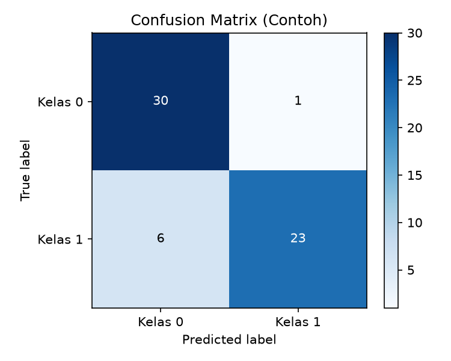
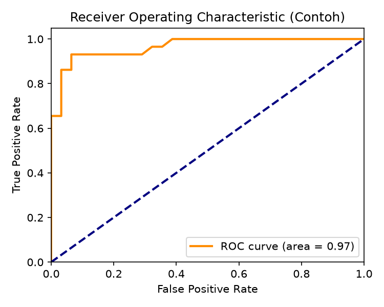

# Results

## Marketing
- **Model**: Random Forest
- **Accuracy**: 94%
- **Key Finding**: Reels content increased engagement by 71% compared to Post.
- **Implication**: Marketing budget allocation should focus more on Reels production.

## HR
- **Model**: Decision Tree
- **Accuracy**: 77%
- **Key Finding**: Absenteeism is the dominant factor affecting staff performance.
- **Implementation**: Focused training programs and attendance incentives can significantly improve performance.

## Operations
- **Model**: SVM + k-NN
- **Accuracy**: 82%
- **Key Finding**: 13.6% of procurement transactions were classified as inefficient.
- **Potential Savings**: Estimated monthly savings of IDR 2.3 million through vendor audits, contract renegotiation, or supplier replacement.

## Results Visualization

### Confusion Matrix (Example)

### ROC Curve (Example)

## Summary
All three classification models successfully identified critical factors in each domain, providing a basis for strategic recommendations that can improve marketing effectiveness, HR performance, and campus operational efficiency.